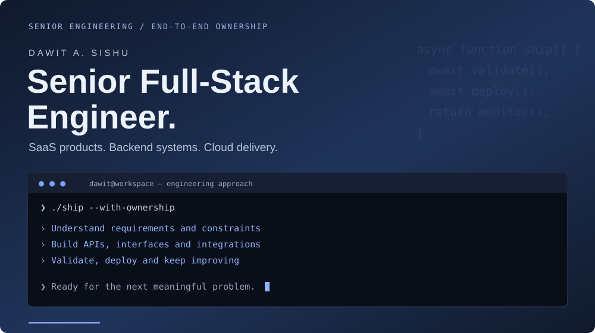
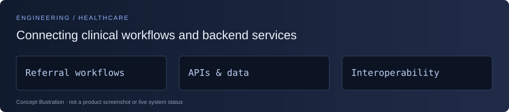
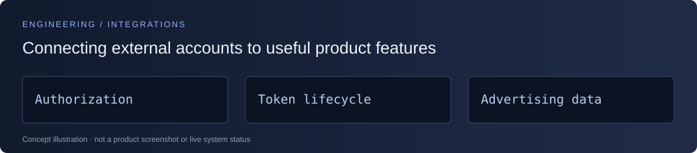
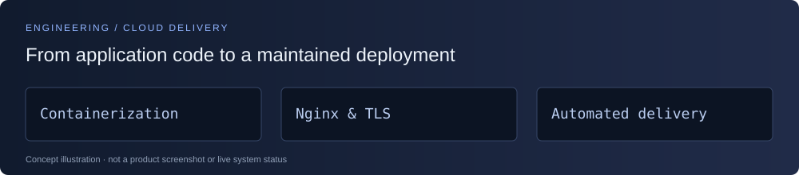

## I build it. Ship it. Keep it moving.

I take SaaS products from unfinished prototypes to production—and stay involved as they grow. My work spans **interfaces, APIs, integrations, databases, and cloud delivery**.

## Selected engineering work

### Healthcare referral platform

**Referral workflows. Secure access. Connected clinical systems.**

I develop backend services, application workflows, and healthcare integrations across **FastAPI, PostgreSQL, Flutter, and Google Cloud**.

<strong>Explore my contributions →</strong>

- **Backend & data:** FastAPI services, SQLAlchemy models, and Alembic migrations.
- **Access & accountability:** authentication changes, permissions, audit logging, and security improvements.
- **Clinical workflows:** referral functionality and role-based application features.
- **Interoperability:** gateway functionality involving FHIR, HL7, and SMART OAuth.
- **Delivery:** Cloud Run, Terraform, GitHub Actions, and automated validation.

---

### Meta-connected SaaS

**From account authorization to usable advertising data.**

I implemented authorization flows, permission checks, token refresh workers, and advertising analytics for a **Node.js / Next.js** product.

<strong>Explore my contributions →</strong>

- Integrated Meta APIs into SaaS account workflows.
- Implemented background token refresh and permission checks.
- Built advertising analytics and brand–creator partnership functionality.

---

### Deployment migration

**A new hosting environment. Continued product support.**

I completed a **Vercel-to-VPS migration** using Docker, Nginx, TLS, and CI/CD, followed by additional AWS troubleshooting and documentation engagements with the same client.

<strong>Explore my contributions →</strong>

- Configured container-based application deployment.
- Set up Nginx and TLS configuration.
- Worked on automated delivery and subsequent infrastructure troubleshooting.
- Documented technical work to support continued maintenance.

Selected client engagements. These describe my contributions within the products; client source code remains in its original repositories.

## How I work

**Understand the system → agree on scope → validate changes → ship → improve.**

Clear tradeoffs. Focused releases. Useful documentation. Updates that tell you what’s done, what’s tested, and what needs attention.

## A focused engineering stack

**Languages**

**Frameworks & runtimes**

**Data & delivery**

**Cloud**

## GitHub in motion

<strong>Explore more repository analytics →</strong>

 

Cards are generated by third-party services from available GitHub activity. Coverage and update times vary; private client work may not be represented.

## Let’s build your next release.

Available for **long-term freelance contracts and ongoing product development**. Tell me about your product, current stack, and what needs to ship next.

*Off the clock: chess, music, and thinking a few moves ahead.*
